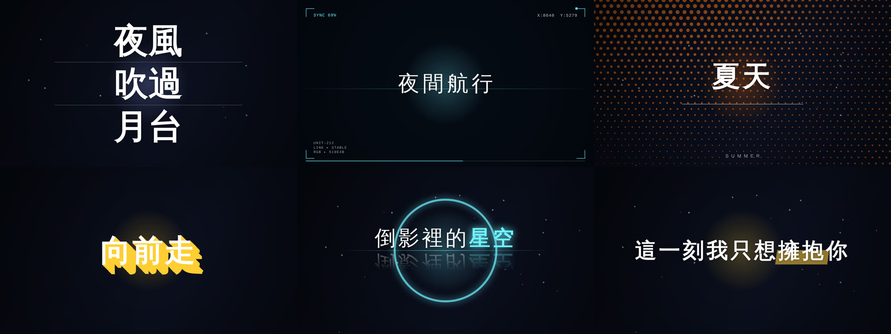
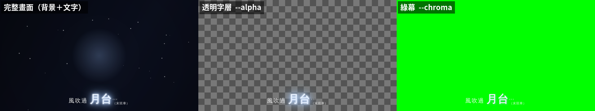

# kinetic-lyric-console · 動態歌詞字幕工具

**繁體中文** | [English](README.en.md)

把 SRT 歌詞變成**會動的字幕**：版型、進場／退場、持續特效、文字樣式、場景層與風格包，網頁即時預覽，可在瀏覽器直接錄製成 MP4／WebM，也能離線渲染成高品質 MP4、透明文字層或綠幕影片，給剪輯軟體直接使用。

**▶ 線上使用（免安裝）：<https://torusmith.github.io/kinetic-lyric-console/>**


<sub>示範歌詞為自創的合成內容；畫面由離線渲染所用的同一個渲染頁面產生（`npm run readme-assets` 可重拍）。</sub>

- **單一 HTML 檔、離線可用**：沒有伺服器、沒有帳號；歌詞、音樂、影片都只在你的瀏覽器裡處理。
- **共 89 種版型、59 種場景層、55 種進場、44 種退場、37 種持續特效、29 種逐字樣式、20 個風格包**（版型與場景各含 28 種實驗室項目）。這是工具實際可用的總數；[`docs/manual.md`](docs/manual.md) 詳列其中的舊版既有部件與 11 個較新的部件；往後新增的卡帶以 `docs/catalog.md` 為準。
- **其中 232 個已做成獨立卡帶檔**（每個效果一個檔案：版型 77、進場 34、退場 37、持續特效 33、文字樣式 14、場景 36、風格包 1，清單見 [`docs/catalog.md`](docs/catalog.md)）；其餘約 100 個是核心內建（例如 `fade`、`rise` 進場、`neon` 樣式、基礎版型），行為相同，只是還沒拆成卡帶。所以「卡帶數」小於「功能總數」是正常的。
- **離線渲染逐格確定**：所有動畫都是時間的純函數，同一份專案用離線渲染每次輸出的逐格結果完全相同。瀏覽器內的「直接錄製」錄的是即時播放的畫面，會受電腦效能影響，不保證逐格相同（見下方[比較表](#輸出影片直接錄製-vs-離線渲染)）。
- **有回歸保護**：新舊畫面逐像素指紋、每個卡帶的合約檢查、位置／綠幕／分層／後製測試。

> 本專案是舊專案 [`Web_Lyric_Subtitle_Tool`](https://github.com/ToruSmith/Web_Lyric_Subtitle_Tool) 的「卡帶化」重構（舊專案不再更動）。

## 效果一覽



由左而右、由上而下：`#justify-stack`、`#hud-frame`、`#poster`（加 `&halftone` 場景）、`#longshadow`、`#mirror-reflect`（加 `&glow-ring` 場景）、`#marker`。版型、進退場、特效、樣式與場景層可以自由搭配，完整清單見 [`docs/catalog.md`](docs/catalog.md)。

## 依你的身分，從這裡開始

| 我是… | 看這裡 |
|---|---|
| **一般使用者**：想把歌詞做成動態字幕 | 下方「[三種使用方式](#三種使用方式)」＋ [`docs/usage.md`](docs/usage.md)（桌面版、本機渲染的完整步驟） |
| **想寫 SRT 特效歌詞的人**（自己寫或請 AI 幫忙） | [**功能手冊與 SRT 標記指南**](docs/manual.md)、[**AI 速查表**](docs/ai-cheatsheet.md) ＋ 下方「[請 AI 幫你上標記](#請-ai-幫你上標記簡單提示詞)」 |
| **想分享自己配色／字體的人**（不寫程式） | [`docs/data-packs.md`](docs/data-packs.md)：匯入／匯出風格包 JSON |
| **人類貢獻者**：想新增一個效果 | [`CONTRIBUTING.md`](CONTRIBUTING.md) → `npm run new-cart -- layout my-id`，再看 [`docs/cart-api.md`](docs/cart-api.md) |
| **AI 工程師／代理程式**：要改這個 repo | [`CLAUDE.md`](CLAUDE.md)（硬規則）→ [`docs/architecture-plan.md`](docs/architecture-plan.md)（架構與決策）→ [`docs/cart-api.md`](docs/cart-api.md)（卡帶合約）→ [`docs/legacy-map.md`](docs/legacy-map.md)（舊檔對照） |

## 三種使用方式

1. **線上網頁版**：打開上面的連結即可；預覽、編輯、直接錄製影片都在網頁裡完成。
2. **桌面版（單檔）**：從 Releases 下載 `kinetic-lyric-console.html`，雙擊用 Chrome／Edge 開啟，不需要安裝。也可以在線上版按 `Ctrl+S` 另存；或下載原始碼後在資料夾執行 `node tools/build.mjs`，再開 `dist/index.html`（原始碼 ZIP 本身沒有 `index.html`）。
3. **本機離線渲染（輸出 MP4／透明字層／綠幕）**：需要 Node.js、ffmpeg 與這個 repo；在網頁匯出「渲染專案」後執行 `node render/run.mjs …`。

三種方式的逐步說明（含 `input/`、`output/` 資料夾怎麼放）→ [`docs/usage.md`](docs/usage.md)。

## 輸出影片：直接錄製 vs 離線渲染

網頁有兩條輸出影片的路，用途不同。頂欄的「匯出」精靈會問你要拿去做什麼，並依選擇給出說明與（離線渲染用的）指令。

| | 🎥 直接錄製 | 🎬 離線渲染 |
|---|---|---|
| 需要安裝 | 不用，最新版 Chrome／Edge 即可 | Node.js、ffmpeg、這個 repo、Playwright 的 Chromium |
| 做法 | 按錄製，授權視窗選「此分頁」並勾選「分享分頁音訊」；倒數 3 秒後即時錄下畫面，結束自動下載 | 在網頁匯出 `project.json`，到終端機執行 `node render/run.mjs …` |
| 輸出 | MP4（瀏覽器支援時）或 WebM，含背景與文字 | 背景＋文字的 MP4、透明文字層、文字／氛圍分層、綠幕 |
| 畫質 | 即時錄影，電腦吃力時可能掉幀；可選 30／60 fps 與輕量模式 | 逐幀截圖後用 ffmpeg 合成，不掉幀；可指定解析度、60 fps，並加動態模糊、輝光、色差、調色 |
| 可重現 | 不保證逐格相同（受電腦效能影響） | 同一專案逐格相同（`--selftest` 可驗證） |
| 適合 | 快速分享、預覽、試效果 | 正式成品、在剪輯軟體疊字或摳綠幕 |

離線渲染可以把同一句話輸出成三種形式（中間的棋盤格代表透明）：



綠幕輸出會移除發光與陰影這類效果（它們會把顏色混進背景），所以右圖的字比左圖少了光暈。

幾個直接錄製的限制：

- 沒有載入音樂或影片，或授權時沒勾「分享分頁音訊」，錄出來是靜音。
- 要錄成指定畫面比例，需要瀏覽器支援 `CropTarget`；不支援時會錄到整個視窗。
- 透明字層、分層、綠幕與後製只有離線渲染能做。

## 請 AI 幫你上標記（簡單提示詞）

工具的 SRT 可以在每一句歌詞前寫標記，例如：

```
1
00:00:01,000 --> 00:00:03,500
#center+rise+fade^bc 夜色漸漸深了

2
00:00:03,500 --> 00:00:05,000
#slam+zoomin+blur-out~shake^bc@outline 不要{回頭}
```

意思是：`#版型` `+進場` `+退場` `~持續特效` `^位置` `@文字樣式`，`{}` 標出關鍵字。完整名稱與規則都在 [功能手冊](docs/manual.md)——它本來就是寫給 AI 讀的。

**做法**：把精簡速查表 [`docs/ai-cheatsheet.md`](docs/ai-cheatsheet.md)（約 16KB，名稱清單由卡帶自動產生，新增的效果也在內）和你的 SRT 一起給 AI，再貼下面其中一段。想讓 AI 看完整說明與每個名稱的細節，可改貼 [`docs/manual.md`](docs/manual.md)（約 57KB）：

**① 整首上標記**
```
請先完整閱讀這份「動態歌詞字幕工具：功能手冊與 SRT 標記指南」。
然後為我的 SRT 每一句加上完整標記，整首風格：【抒情慢歌／熱血／賽博／復古…挑一個或自己描述】。
只能使用手冊裡列出的名稱，輸出格式照手冊第 11 節（一個程式碼區塊、保留原序號與時間碼）。
【貼上你的 SRT】
```

**② 只調整幾句**
```
依照這份手冊，只修改下面第 5、6、12 句的標記：改成更【安靜／更有力】的感覺，其他句子原封不動。
【貼上帶標記的 SRT】
```

**③ 同時要全域設定**
```
依照這份手冊為整首上標記，另外附一小段 config JSON（3–6 個欄位），讓整體配色與字體符合【主題】。
```

拿到 AI 回覆後：存成 `.srt` → 網頁頂欄 **載入 ▾ → 載入字幕** 就能預覽；喜歡的話再用 **匯出** 精靈輸出。名稱寫錯時工具不會壞（未知版型會退回 `lowerleft`），載入字幕時提示列會列出不認得的名稱；可以直接請 AI「只用速查表裡的名稱重寫」。

> 手冊的名稱表涵蓋舊版既有的項目；速查表（`docs/ai-cheatsheet.md`）與 [`docs/catalog.md`](docs/catalog.md) 則由卡帶自動產生，包含之後新增的項目。每個 Release 也附有 `ai-cheatsheet.md`，可直接下載。

## 使用前請注意

- **光敏提醒**：`flicker`、`glitch`、`shake`、`rainbow`、閃電疊加層、`flash-words` 版型等會造成快速明暗或畫面閃爍，對光敏性癲癇或對閃爍敏感的觀眾有風險。公開發布前請避免大面積、高頻、連續使用，並在影片說明加上提醒；網頁的匯出精靈也會在輸出影片時提示。
- **素材授權**：歌曲、歌詞與背景影片的著作權在你手上的素材本身，請確認你有使用與發布的授權；本工具只負責畫面效果。
- **第三方內容**：部分版型與動畫移植自 JIZURA（MIT），授權標示見 [`THIRD_PARTY_NOTICES.md`](THIRD_PARTY_NOTICES.md)。

## 專案結構

```
core/    主機：解析、時間軸、編輯器、匯出；卡帶登記層（api/console.js）
carts/   卡帶，一個效果一個檔案：layout enter exit fx style scene pack（_template 是範本）
render/  離線渲染（Node＋Playwright＋ffmpeg）
tools/   建置（build）、新增卡帶（new-cart）、清單與速查表產生（gen-catalog、gen-cheatsheet）、縮圖（make-thumbs）
test/    合約、位置、綠幕、分層、後製、行為等測試；golden/ 是畫面指紋基準
docs/    手冊、卡帶合約、架構規劃、使用說明
```

6 個依賴全域畫面功能的版型（text-mask、hanko、ink-bleed、ripple-pool、constellation、particle-form）維持在 `core/legacy/`，不做成卡帶——它們要注入 SVG 濾鏡、註冊 CSS 屬性或使用水面 GL，不符合卡帶「純函式、不碰全域」的規則。

## 開發

```
npm ci               # 只有跑 lint／測試／渲染才需要；單純建置可省略
npm run build        # 等同 node tools/build.mjs → dist/index.html（單檔）
npm run lint
npm run check:fast   # 快速檢查（約 20 秒）：建置、lint、載入、行為、規格同步等；改文字或小地方先跑這個
npm run check        # 完整驗證（約 40–60 分鐘；日常只跑相關測試即可）
npm run regress      # 與 test/golden 指紋比對畫面
npm run catalog      # 重新產生 docs/catalog.md
npm run cheatsheet   # 重新產生 docs/ai-cheatsheet.md
```

GitHub Actions 額度有限，驗證優先在本機跑；規則見 [`docs/architecture-plan.md`](docs/architecture-plan.md) 第 8 節。

## 授權

MIT，見 [`LICENSE`](LICENSE)。第三方內容（JIZURA 等）見 [`THIRD_PARTY_NOTICES.md`](THIRD_PARTY_NOTICES.md)。
